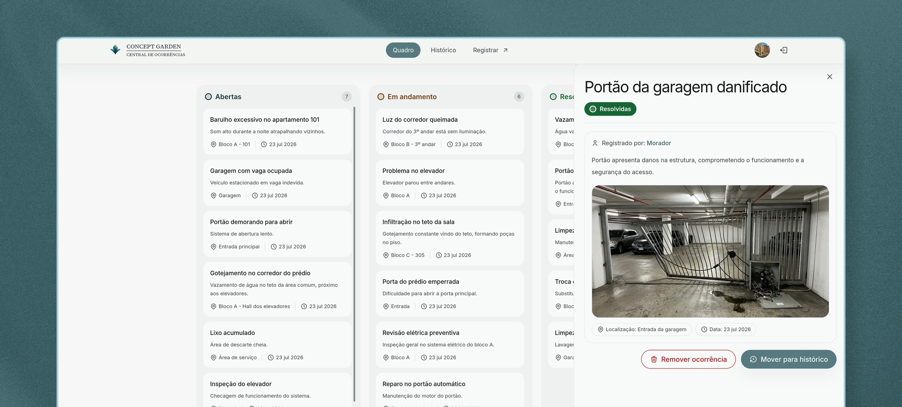

#  Central de Ocorrências | Concept Garden



<div>
    
    
    
    
    
    
    
    
</div>

A **Central de Ocorrências** é uma aplicação web para o condomínio registrar e gerenciar ocorrências. Moradores e funcionários podem abrir chamados por um formulário público, enquanto a administração acompanha tudo em um quadro Kanban, com histórico, mudança de status, arquivamento e remoção das ocorrências.

O projeto é dividido em um front-end em **Next.js** e uma API em **Fastify**, com persistência em **SQLite** (via Prisma) e armazenamento das imagens no **MinIO**.

## Funcionalidades

- Registro público de ocorrências por moradores e funcionários, com upload opcional de imagem.
- Área administrativa protegida por autenticação **JWT**.
- Quadro **Kanban** com arrastar-e-soltar entre os status **Aberta**, **Em andamento** e **Resolvida**.
- Histórico de ocorrências, com arquivamento e remoção.
- Atualização do avatar e dos dados do administrador.
- Armazenamento de imagens no MinIO (buckets `admin` e `occurrences`).
- Feedback de ações e erros por notificações (toasts) com **Sonner**.
- API documentada com **Swagger/Scalar** e coleção de requisições no **Bruno**.
- Validação de entrada com **Zod** e limitação de requisições (rate limit).

## Stack

| Camada         | Tecnologias                                                               |
| -------------- | ------------------------------------------------------------------------- |
| Front-end      | Next.js 16 (App Router), TypeScript, Tailwind CSS 4, React Hook Form, Zod |
| Back-end       | Fastify 5, TypeScript, Zod, JWT, Prisma 7                                 |
| Banco de dados | SQLite                                                                    |
| Armazenamento  | MinIO (S3 compatível)                                                     |
| Infra          | Docker, Docker Compose, Nginx, Gitea Actions                              |

## Estrutura do projeto

```
central-de-ocorrencias/
├── .assets/                    # logo e preview usados no README
├── .gitea/workflows/           # pipeline de CI (Gitea Actions)
├── backend/
│   ├── docs/bruno/             # coleção de requisições (Bruno)
│   ├── prisma/
│   │   ├── migrations/         # migrations do SQLite
│   │   ├── mocks/              # ocorrências de exemplo
│   │   ├── seeds/              # admin inicial e ocorrências de exemplo
│   │   └── src/generated/      # client gerado pelo Prisma
│   ├── src/
│   │   ├── controllers/        # regras de negócio por recurso
│   │   ├── routes/             # rotas do Fastify
│   │   ├── schemas/            # validação com Zod
│   │   ├── plugins/            # JWT, Swagger e tratamento de erros
│   │   ├── middlewares/        # autenticação
│   │   ├── lib/                # Prisma, MinIO e bcrypt
│   │   ├── constants/          # MIME types aceitos
│   │   ├── database/           # arquivo SQLite local
│   │   └── types/              # tipos auxiliares
│   └── tests/performance/      # testes de carga com autocannon
├── frontend/
│   └── src/
│       ├── app/                # rotas: (public), admin/(auth) e admin/(panel)
│       ├── components/         # UI por domínio (board, history, register, ui)
│       ├── lib/                # sessão no servidor e validações
│       ├── services/api/       # client HTTP e serviços por domínio
│       ├── constants/          # constantes de UI
│       └── types/              # tipos do domínio
├── infra/
│   ├── nginx/                  # reverse proxy (front-end + /api)
│   └── gitea-runner/           # runner de CI (compose separado)
├── setup/
│   ├── scripts/                # minio-init.sh (buckets e imagens)
│   └── storage/                # imagens de exemplo (avatar e ocorrências)
├── compose.yml                 # MinIO, backend, frontend e Nginx
└── README.md
```

## Pré-requisitos

- **Node.js** 22 ou superior (o CI usa a versão 24)
- **pnpm** 11
- **Docker** e **Docker Compose** (para o ambiente completo)

## Variáveis de ambiente

O projeto usa três arquivos de ambiente:

### `.env` (raiz) para credenciais do MinIO

Usado pelo `compose.yml` para subir o MinIO:

```env
MINIO_ROOT_USER=admin
MINIO_ROOT_PASSWORD=minioadmin
```

### `backend/.env` para configuração da API

Use `backend/.env.example` como base:

```env
PORT=3333
HOST=0.0.0.0
BASE_URL=http://localhost:3333
DATABASE_URL="file:./src/database/database.sqlite"
CORS_ORIGIN=http://localhost:3000
JWT_SECRET=your_jwt_secret_here

ADMIN_EMAIL=admin@concept-garden.com
ADMIN_PASSWORD=admin
ADMIN_IMAGE=http://127.0.0.1:9000/admin/avatar.webp

MINIO_ENDPOINT=127.0.0.1
MINIO_PORT=9000
MINIO_USE_SSL=false
MINIO_ACCESS_KEY=admin
MINIO_SECRET_KEY=minioadmin
MINIO_ADMIN_BUCKET=admin
MINIO_OCCURRENCES_BUCKET=occurrences
MINIO_PUBLIC_URL=http://127.0.0.1:9000

DISABLE_RATE_LIMIT=false
```

> As credenciais `ADMIN_EMAIL` e `ADMIN_PASSWORD` são usadas pelo seed para criar o administrador inicial.

### `frontend/.env` para configuração do front-end

Use `frontend/.env.example` como base (ele já vem com os valores usados no Docker):

| Variável              | Padrão                  | Descrição                                                                          |
| --------------------- | ----------------------- | ---------------------------------------------------------------------------------- |
| `NEXT_PUBLIC_API_URL` | `http://localhost:3333` | Base das requisições do **navegador**. No Docker é `/api`. Inlinada em build time. |
| `API_SERVER_ORIGIN`   | `http://localhost:8080` | Origem das requisições no **servidor (SSR)**. No Docker é `http://nginx`.          |
| `ALLOWED_DEV_HOST`    | vazio                   | Hosts extras liberados pelo `next dev` (ex.: acesso por IP da rede local).         |
| `ALLOWED_DEV_IP`      | vazio                   | IP extra liberado pelo `next dev`.                                                 |

Rodando o front-end sem Docker e sem Nginx, defina `NEXT_PUBLIC_API_URL=http://localhost:3333` e `API_SERVER_ORIGIN=http://localhost:3333`.

## Rodando com Docker Compose

Com os três arquivos `.env` preenchidos:

```bash
docker compose up --build
```

Serviços disponíveis:

| Serviço  | Endereço              | Descrição                                     |
| -------- | --------------------- | --------------------------------------------- |
| Nginx    | http://localhost:8080 | Proxy reverso para front-end e backend (API). |
| MinIO    | http://localhost:9000 | API S3                                        |
| MinIO    | http://localhost:9001 | Console web                                   |
| Backend  | interno (porta 3333)  | API, acessível via Nginx em `/api/`           |
| Frontend | interno (porta 3000)  | Next.js, acessível via Nginx                  |

Páginas principais:

- **Registro público**: http://localhost:8080/registrar
- **Login administrativo**: http://localhost:8080/admin

Para parar o ambiente:

```bash
docker compose down          # mantém os dados do MinIO
docker compose down -v       # remove também o volume do MinIO
```

## Rodando localmente (sem Docker)

### Back-end

```bash
cd backend
pnpm install
cp .env.example .env          # ajuste as credenciais do MinIO e do admin
pnpm prisma migrate deploy    # aplica as migrations
pnpm db:seed                  # cria o admin e ocorrências de exemplo
pnpm dev
```

> Para as imagens, suba apenas o MinIO: `docker compose up -d minio minio-init`.

A API ficará em `http://localhost:3333` e a documentação (Scalar) em `http://localhost:3333/docs`.

### Front-end

```bash
cd frontend
pnpm install
cp .env.example .env   # no local: NEXT_PUBLIC_API_URL e API_SERVER_ORIGIN em http://localhost:3333
pnpm dev
```

O front-end ficará em `http://localhost:3000` (ou na porta indicada pelo Next). Para o SSR conseguir falar com a API local, defina `API_SERVER_ORIGIN=http://localhost:3333`.

## API

A API gera a documentação automaticamente a partir do schema **OpenAPI/Swagger** e a expõe via **Scalar** em `/docs` quando o back-end roda diretamente (`pnpm dev`). No Docker, a porta `3333` não é exposta publicamente e o acesso externo é feito pelo Nginx em `/api/`.

Principais endpoints:

| Método | Rota                       | Descrição                             | Autenticação |
| ------ | -------------------------- | ------------------------------------- | ------------ |
| POST   | `/auth/login`              | Login do administrador                | Não          |
| GET    | `/me`                      | Dados do administrador autenticado    | Sim          |
| PATCH  | `/me/avatar`               | Atualiza o avatar                     | Sim          |
| GET    | `/public/condominium`      | Imagem de identificação do condomínio | Não          |
| POST   | `/public/occurrences`      | Cria uma ocorrência (multipart)       | Não          |
| GET    | `/occurrences`             | Lista as ocorrências                  | Sim          |
| GET    | `/occurrences/:id`         | Busca uma ocorrência                  | Sim          |
| PATCH  | `/occurrences/:id/status`  | Atualiza o status                     | Sim          |
| PATCH  | `/occurrences/:id/archive` | Arquiva/desarquiva                    | Sim          |
| DELETE | `/occurrences/:id`         | Remove uma ocorrência                 | Sim          |

A coleção de requisições está em `backend/docs/bruno/` e pode ser importada no [Bruno](https://www.usebruno.com/).

## Scripts

### Back-end (`backend/`)

| Script            | Descrição                                       |
| ----------------- | ----------------------------------------------- |
| `pnpm dev`        | Sobe a API em modo watch                        |
| `pnpm build`      | Gera o build de produção (`dist/`)              |
| `pnpm start`      | Executa o build                                 |
| `pnpm db:seed`    | Popula o banco (admin + ocorrências)            |
| `pnpm db:reset`   | Recria o banco e roda as migrations             |
| `pnpm admin:sync` | Sincroniza as credenciais do admin com o `.env` |
| `pnpm studio`     | Abre o Prisma Studio                            |
| `pnpm check`      | Verifica formatação, lint e tipos               |
| `pnpm perf`       | Testes de carga (throughput e latência)         |

> `pnpm perf` lê `BASE_URL`, `ADMIN_EMAIL` e `ADMIN_PASSWORD` do `backend/.env` e dispara **10 conexões simultâneas por 20 segundos**. Rode com `DISABLE_RATE_LIMIT=true` no `.env` e reinicie o back-end: com o limitador ativo (100 req/min global e 5 req/min no login), a maioria das requisições retorna `429` e o resultado mede o limitador, não a API.

### Front-end (`frontend/`)

| Script       | Descrição                                      |
| ------------ | ---------------------------------------------- |
| `pnpm dev`   | Sobe o Next.js em modo dev                     |
| `pnpm build` | Gera o build de produção                       |
| `pnpm start` | Sobe o servidor standalone (após `pnpm build`) |
| `pnpm check` | Verifica formatação, lint e tipos              |

## Qualidade e CI

Os dois projetos expõem os mesmos scripts de qualidade:

| Script              | Descrição                                    |
| ------------------- | -------------------------------------------- |
| `pnpm format`       | Formata o código com Prettier                |
| `pnpm format:check` | Verifica a formatação sem alterar arquivos   |
| `pnpm lint`         | Analisa o código com ESLint                  |
| `pnpm lint:fix`     | Corrige automaticamente o que for possível   |
| `pnpm typecheck`    | Verifica os tipos com `tsc --noEmit`         |
| `pnpm check`        | Executa `format:check`, `lint` e `typecheck` |

- **Gitea Actions** (`.gitea/workflows/ci.yml`): em pull requests para a branch `dev`, roda `pnpm check` no back-end.
- **Testes de carga** com autocannon ficam em `backend/tests/performance/` e cobrem `POST /auth/login` e `GET /occurrences`.

## Observações

- Os buckets do MinIO são criados e deixados públicos (leitura) pelo script `setup/scripts/minio-init.sh`, que também envia imagens de exemplo em ambiente de desenvolvimento.
- Limites de upload: imagens de ocorrência até **5 MB** e avatares até **2 MB**, validadas por tipo de arquivo e processadas com `sharp`.
- Rate limit global de **100 requisições/minuto** e **5 requisições/minuto** no login (desativável com `DISABLE_RATE_LIMIT=true`).
